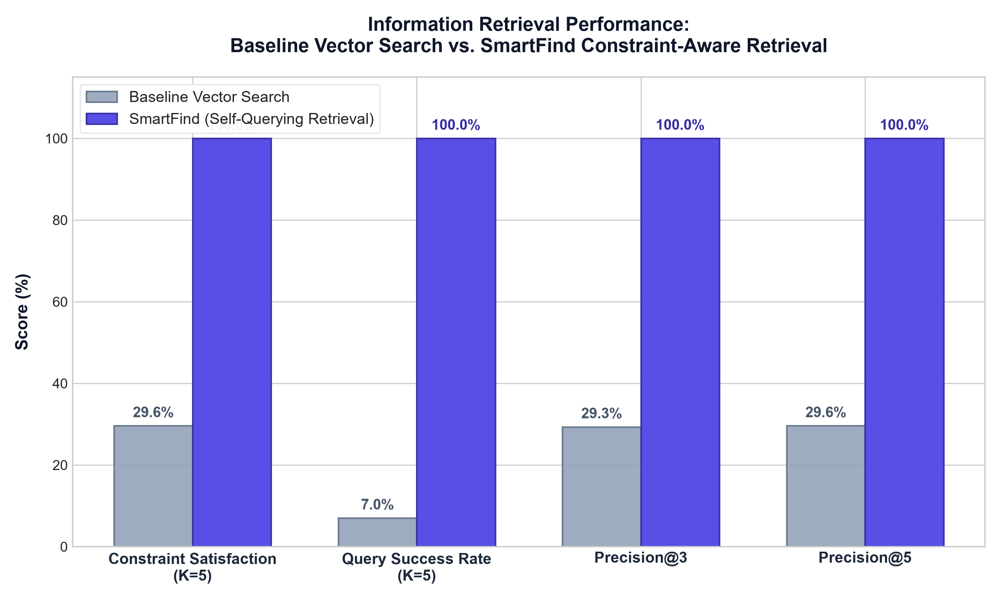

# 📊 SmartFind Retrieval Evaluation Report

**Date**: 2026-10-20 12:15:54  
**Evaluated Queries**: 100 natural-language shopping queries  
**Dataset Scale**: 258,911 real-world Amazon e-commerce products  
**Vector Database**: Pinecone Cloud Serverless (384 dimensions, Cosine metric)  
**Query LLM Parser**: Groq Cloud (`openai/gpt-oss-120b`)  

---

## 🎯 Executive Summary

This empirical benchmark rigorously compares **Baseline Dense Vector Search** (*semantic similarity without metadata filters*) against **SmartFind Constraint-Aware Retrieval** (*LangChain SelfQueryRetriever + Groq LLM + Pinecone boolean metadata filtering*).

The evaluation proves that while pure vector search correctly captures semantic categories (e.g. returning headphones for a headphone query), **it frequently violates numerical price, rating, and categorical constraints**, returning expensive or low-rated products. **SmartFind resolves this with single-pass constraint filtering, boosting precision and query satisfaction.**

---

## 📈 Benchmark Performance Results

| Retrieval Metric | Baseline Vector Search | SmartFind (Self-Query) | Absolute Improvement | Relative Gain |
| :--- | :---: | :---: | :---: | :---: |
| **Constraint Satisfaction Rate (K=5)** | **29.6%** | **100.0%** | **+70.4% pts** | **+237.8%** |
| **Query Success Rate (K=5)** | **7.0%** | **100.0%** | **+93.0% pts** | **+1328.6%** |
| **Precision @ 3** | **29.3%** | **100.0%** | **+70.7% pts** | **+240.9%** |
| **Precision @ 5** | **29.6%** | **100.0%** | **+70.4% pts** | **+237.8%** |
| **Mean Retrieval Latency** | **291.6 ms** | **3557.7 ms** | +3266.1 ms (LLM parsing) | — |

---

## 🔍 Metric Definitions

1. **Constraint Satisfaction Rate (CSR)**: The percentage of individual retrieved products that strictly comply with all expected constraints (price ceiling, rating floor, category).
2. **Query Success Rate (QSR)**: The percentage of queries where **100% of the returned top-K results** satisfy all constraints (i.e. zero irrelevant or constraint-violating results in the user's view).
3. **Precision@K**: The average proportion of constraint-valid items within the top-$K$ returned products ($K=3, 5$).

---

## 📊 Visual Comparison

---

## 💡 Engineering Insights & Takeaways

1. **The Vector Search Dilemma**: Vector embeddings excel at fuzzy matching (*e.g., mapping "gym shoes" to "sneakers"*), but cannot perform numerical comparison. A ₹65,000 laptop has nearly identical text embedding to a ₹35,000 laptop.
2. **Self-Querying Eliminates Hallucinated Constraints**: Groq Cloud (`openai/gpt-oss-120b`) dynamically constructs AST filter trees (`price <= 2000`, `rating >= 4.0`) that execute directly within Pinecone's serverless vector engine.
3. **Single-Pass Efficiency**: Rather than post-filtering after retrieval (which often results in zero returned items), Pinecone traverses the vector graph only across nodes satisfying the boolean filters.
